<div align="center">

# 任课教师工作台

**给同时教好几个班的任课老师用的电脑工作台**

课表与调课 · 教学进度 · 作业登记 · 单科成绩与平行班分析 · 调座位 · AI 教学助理

一个 HTML 文件，双击就能用；教学数据保存在本机浏览器，AI 服务按需连接

[在线体验](https://cyberdaddyleo.github.io/workstation-subject-teacher/) · [下载使用](#下载使用) · [快速上手](#快速上手) · [详细使用指南](docs/使用指南.md) · [常见问题](#常见问题)

个人工作台系列 · 第 5 期

</div>

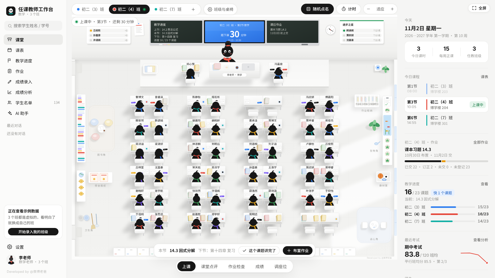

---

## 软件说明

任课教师工作台是一款面向任课教师的电脑教学管理工具，适合同一学科、多班级的日常教学。它把课堂管理、教学安排、作业收交和成绩分析集中在一个工作台中，普通功能可离线使用，无需安装或注册。

| 项目 | 说明 |
|---|---|
| 当前版本 | v1.0.0 · 个人工作台系列第 5 期 |
| 适用设备 | 办公电脑、教室一体机、智慧黑板；以桌面端为主 |
| 打开方式 | 在线体验，或下载解压后双击 `index.html` |
| 建议浏览器 | Chrome / Edge；需要允许本地存储 |
| 数据保存 | 当前浏览器本地存储；不提供账号与跨设备自动同步 |
| AI 功能 | 可选；调用外部服务需联网及相应接口权限，也可复制提示词使用 |
| 使用许可 | 个人免费、非商业使用，完整条款见 [LICENSE](LICENSE) |

初次使用可按本文的「快速上手」操作；完整步骤、导入格式、备份恢复和常见问题见 **[使用指南](docs/使用指南.md)**。

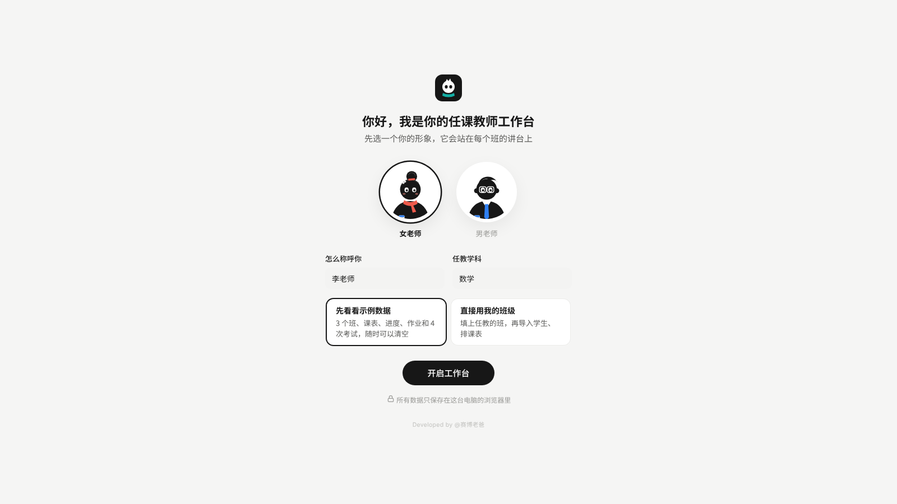

## 为什么做这个

班主任管一个班，任课老师往往要教三四个班。每个班进度不一样、作业要分开收、考完试还要比平行班，课表还时不时调课。这些事情散落在课表纸、作业登记本、Excel 和微信群里。

任课教师工作台把它们放到一个页面里：**打开就知道今天上哪几节课、每个班讲到哪了、谁没交作业、这次考试哪类题失分最多**。

和第 1 期「班主任工作台」相比：

| | 班主任工作台 | 任课教师工作台 |
|---|---|---|
| 班级 | 一个班 | 多个班，顶部一键切换 |
| 学生信息 | 完整学籍档案 | 只记上课需要的：姓名、学号、标签、备注 |
| 成绩 | 各科总分、排名 | 只记本学科，可按大题 / 题型录入 |
| 日常管理 | 考勤、排座 | 课表与调课、教学进度、作业登记 |
| 分析 | 班级内 | 班级内 + 平行班对比 + 临界生 |

## 功能一览

### 课堂（主页）

- 每个任教班级一间「教室」，按课表自动显示 **上课中 · 还剩 xx 分钟**
- 黑板上自动写好本节课题、下节课题和课后作业
- 智慧屏可以当课堂计时器，时间到有提示音
- 五种模式：**上课 / 课堂点评 / 作业检查 / 成绩 / 调座位**
- 随机点名（最近点过的同学不重复）、全班 +1、课堂积分榜
- 右侧栏：今日课程、本班作业上交情况、各班进度对比、最近考试、待办

### 桌椅与座位

- 每个班单独设置：**单人单列 / 双人同桌 / 三人一排**，行列可以按人数自动排，也可以自己定
- **调座位**：拖动学生换座位；在一体机、智慧黑板上可以先点学生再点座位
- **讲台两边可以加座位**（每边最多 2 张，默认没有）
- 支持撤销，一键恢复按学号排

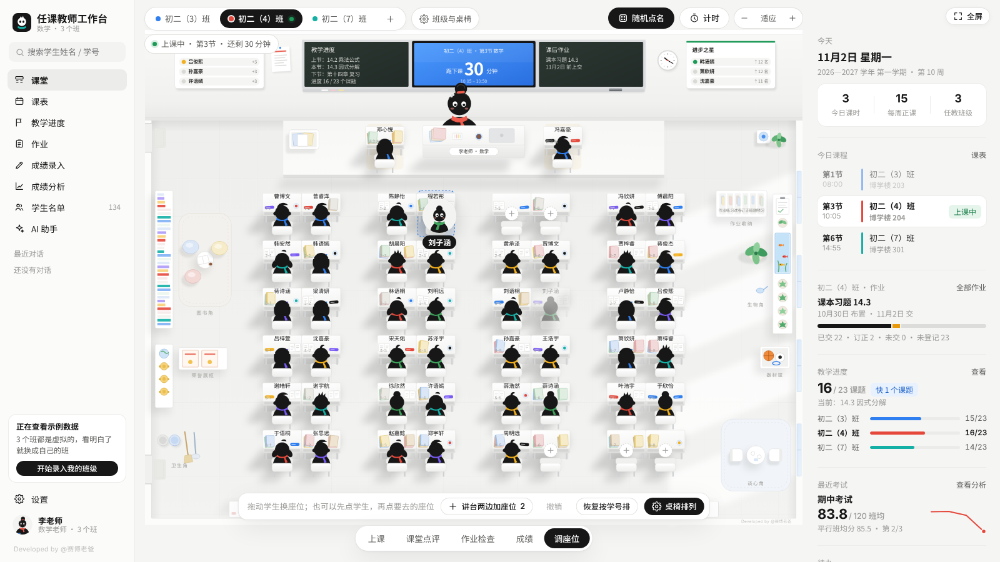

### 课表

- 每周固定课表 + 临时调整：调课、代课、两节课对调、全天停课（放假、运动会、考试）
- 每个班每周课时统计，调课后自动核对这一周实际课时
- 打印课表；**导出到手机日历**（每节课前 10 分钟提醒，调课停课已算进去）
- 作息时间可改，内置小学 / 初中 / 高中常见作息

### 教学进度

- 从教学计划里复制「课题 + 计划课时」两列就能导入
- 每个班讲完一个课题点一下，自动推算各班是快了还是慢了

### 作业

- 一次布置给几个班，截止日默认是这个班的下一次上课
- 逐个登记：已交 / 优秀 / 需订正 / 未交，或者「其余都已交」
- **一键复制未交名单**，直接发给课代表或家长群
- 每个班的上交率趋势，自动列出经常不交作业的同学

### 成绩录入

- 一场考试可以包含几个平行班，按班分开录
- 可以只录总分，也可以 **按大题 / 题型录入**（选择、填空、解答，或积累、阅读、作文等）
- 从 Excel 复制一整块分数直接粘贴；也支持按表头导入、导出 CSV
- 缺考填「缺」，不计入统计

### 成绩分析

- 平均分、最高最低、及格率、优秀率、低分率、标准差，和上次考试自动对比
- 自动写出几条「本次要点」
- **平行班对比**：各班指标表、分数段分布、历次趋势
- **分项得分率**：一眼看出哪类题失分最多、哪个班在哪类题上最弱
- **临界生名单**：差几分就及格、差几分就优秀的同学，最容易提分的一批
- 进步明显 / 退步较多的同学，点名字直接看个人详情

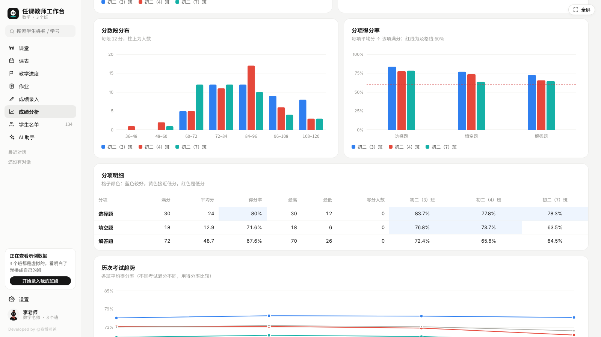

### 学生名单

- 支持从班主任发来的 Excel 名单直接粘贴导入
- 学生详情：本学科成绩走势、分项得分率、作业记录、课堂表现、学科评语

### AI 教学助理（可选）

- 内置 DeepSeek、通义千问、Kimi、智谱 GLM、豆包、硅基流动、OpenAI、Claude、Ollama 本地模型，也支持任何 OpenAI 兼容接口
- 模板：备课教案、课件大纲、分层作业、说课稿、单元复习课、试卷分析报告、试卷讲评课、临界生辅导计划、家长沟通、学科通知、批量学科评语、进步表扬语、教学反思、教学工作总结
- 会自动带上班级进度、成绩、作业等数据，写出来的东西更贴合你的班
- **姓名脱敏**：开启脱敏后，发送前将学生姓名替换为编号，结果返回后再还原；发送前仍应检查提示词和所选资料
- **没有 API Key 也能用**：一键复制提示词，粘贴到豆包、DeepSeek、Kimi 等任意网页版
- 生成的内容可以导出 Word

## 截图

| | |
|---|---|
| 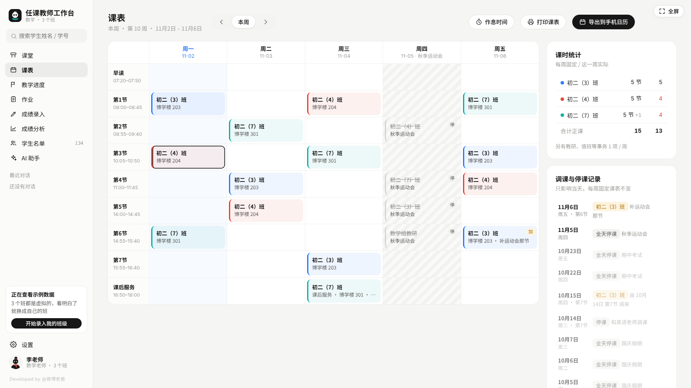 课表与调课 | 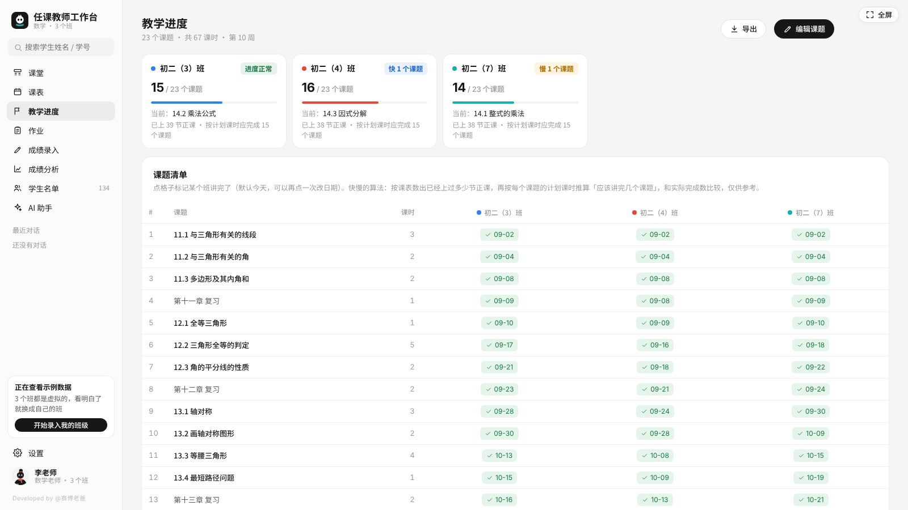 教学进度 |
| 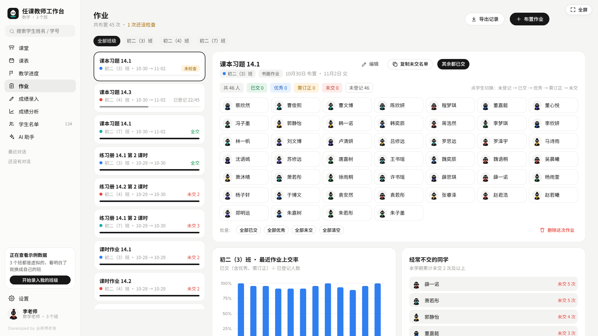 作业登记 | 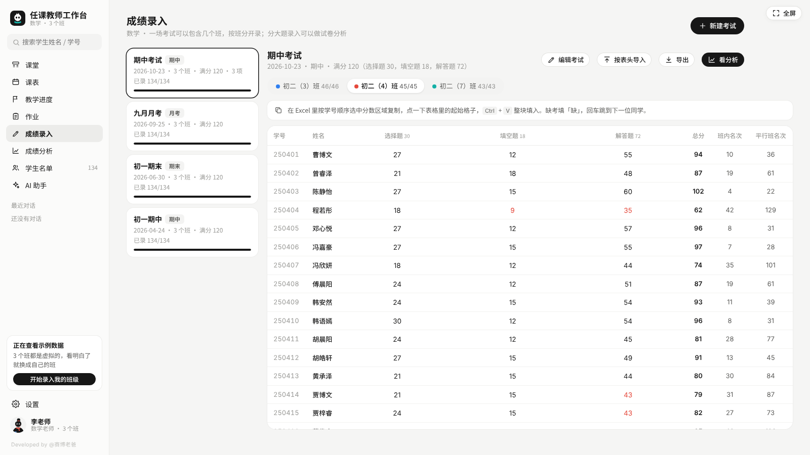 成绩录入（按大题） |
| 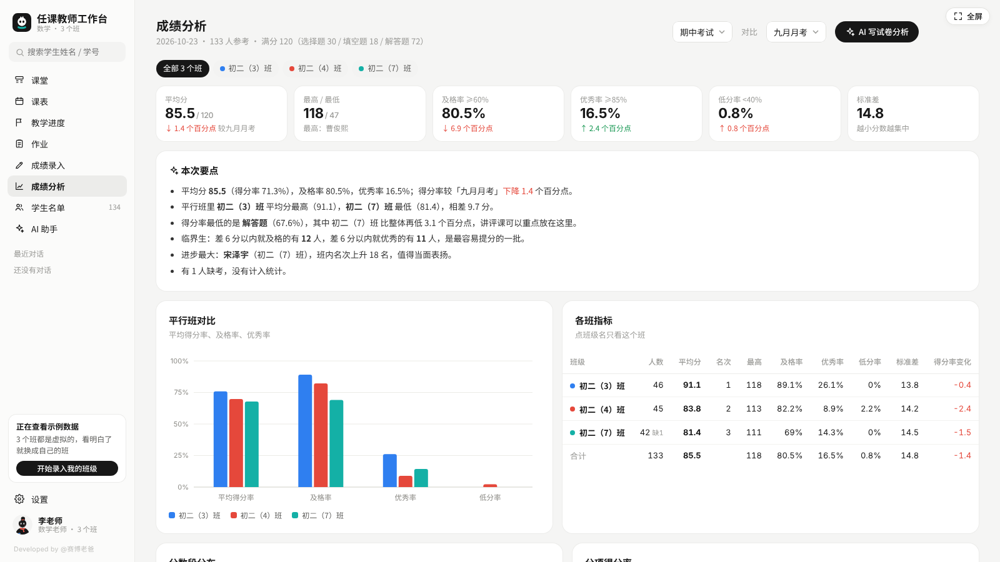 平行班对比 | 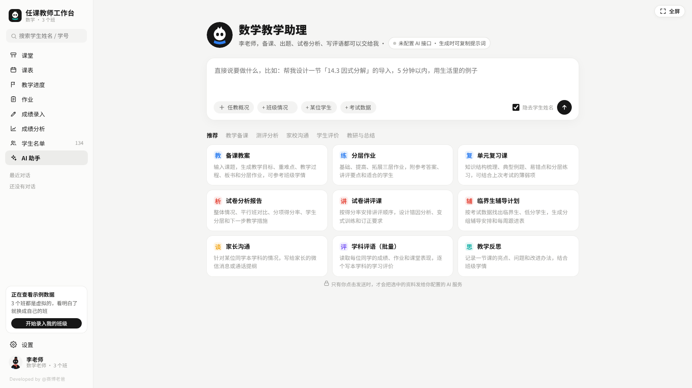 AI 教学助理 |
| 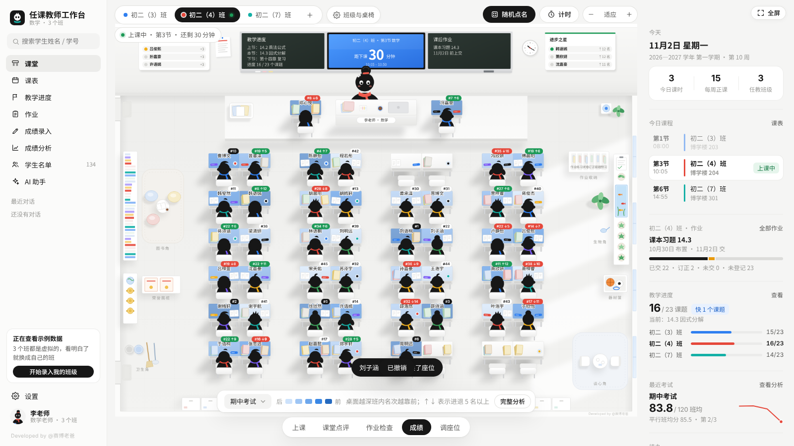 课堂 · 成绩模式 | 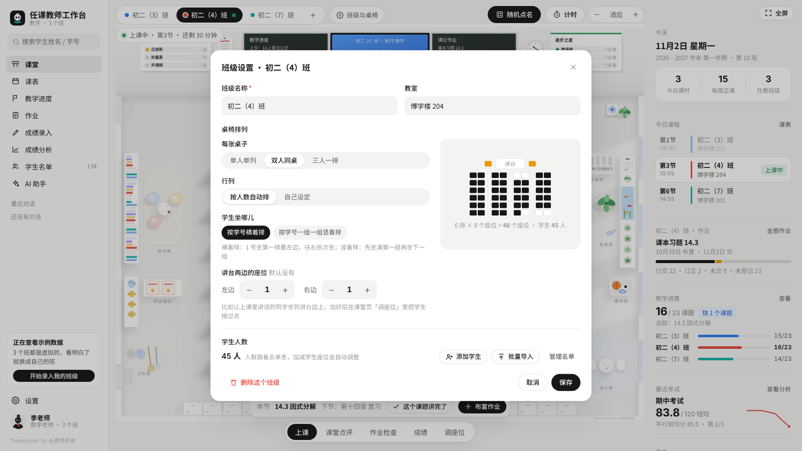 班级与桌椅设置 |

## 下载使用

**方式一：在线用**
打开 [在线体验](https://cyberdaddyleo.github.io/workstation-subject-teacher/) 即可。数据同样只保存在你当前使用的浏览器里。

**方式二：下载到电脑**
1. 点页面右上方绿色的 **Code → Download ZIP**（或者到右侧 **Releases** 下载）
2. 解压后双击 `index.html`，用 Chrome 或 Edge 打开
3. 可以把它固定到浏览器书签，或者发到桌面

不需要安装、不需要注册、不需要联网（AI 功能除外）。

## 快速上手

1. **第一次打开**：选一个老师形象，填称呼和学科。可以先看示例数据（3 个班、4 次考试），看明白了点左下角「开始录入我的班级」清空
2. **建班级**：课堂页顶部点「+」，填班级名称，选课桌是单人还是双人；学生名单可以直接粘贴进来
3. **导入学生**：也可以在「学生名单 → 批量导入」里，从 Excel 复制（第一行是表头）粘贴
4. **排课表**：「课表」页点任意格子，选班级，选「每周都这样」就是固定课表；临时调课选「只改这一次」
5. **填教学进度**：「教学进度 → 编辑课题」，从教学计划里复制课题和课时两列
6. **上课**：打开课堂页，点名、点评、检查作业都在底部切换
7. **考试后**：「成绩录入 → 新建考试」，选参考班级；需要试卷分析就选「按大题录入」

## AI 助手怎么配置

1. 到任意一家服务商注册并创建 API Key（例如 DeepSeek 开放平台）
2. 工作台里打开 **设置 → AI 接口**，选服务商，粘贴 Key，点「测试连接」
3. 看到「连接成功」就可以用了

Key 保存在本机浏览器；测试连接或调用 AI 时，会作为鉴权信息发送给你配置的服务商。使用本地转发工具时，请求会经由本机转发到该服务商。

**提示连不上？** 有的服务商不允许网页直接调用。可以换一家，或者用仓库里的 `ai-proxy.js` 在本机转发：

```bash
# 需要先安装 Node.js 18 或更新版本
node ai-proxy.js
```

然后把接口地址改成 `http://127.0.0.1:8787/` 加原来的地址，例如：

```
http://127.0.0.1:8787/https://api.deepseek.com
```

## 数据与隐私

- 教学记录默认保存在 **当前电脑、当前浏览器** 的本地存储里，不会自动同步到 GitHub 或作者服务器
- 换浏览器、换电脑或切换在线版与本地版，数据不会自动同步；**清理浏览器数据会把它删掉**
- 请定期到 **设置 → 数据与备份 → 导出备份** 保存一份 `.json` 文件；换电脑时用「从备份恢复」导入
- AI 测试连接会向配置的服务发送测试请求；生成内容时会发送提示词、对话及选中的资料。姓名脱敏不能替代发送前的内容检查
- 备份包含教学记录和 AI 配置，可能包括 API Key 与对话；请妥善保管，不要上传到公开仓库或随意分享

## 常见问题

**手机上能用吗？**
目前只做了电脑版，适合办公电脑和教室一体机。推荐 Chrome 或 Edge 最新版。

**教室一体机 / 智慧黑板上能拖动吗？**
可以。拖不顺的话，用「先点学生，再点要去的座位」。

**投屏上课时要注意什么？**
投屏时用「上课」或「课堂点评」模式。「成绩」模式会显示每位同学的名次，不建议投到大屏上。

**课表怎么放到手机上？**
课表页点「导出到手机日历」，得到一个 `.ics` 文件。苹果手机：发到微信文件传输助手或邮箱，在手机上打开，选「添加全部」；安卓手机和电脑：用系统日历、Outlook 等「导入」这个文件。

**及格线不是 60% 怎么办？**
设置 → 成绩线与点评，可以改及格线、优秀线、低分线。

**成绩能导出给教务吗？**
可以，成绩录入页点「导出」，得到 CSV 文件，用 Excel 打开即可。

**一个班的人数变了怎么办？**
在学生名单里加减学生就行，教室里的座位会自动调整；也可以在「班级与桌椅」里自己定几排几列。

## 文件说明

```
workstation-subject-teacher/
├── index.html        工作台本体（单文件，双击打开）
├── ai-proxy.js       本地 AI 转发小工具（可选，AI 连不上时才需要）
├── docs/使用指南.md  完整使用步骤与常见问题
├── screenshots/      12 张说明截图
├── .gitignore        本地文件与备份忽略规则
├── LICENSE           开源协议
└── README.md         本说明
```

## 开源协议

本项目采用 **非商业使用许可**，详见 [LICENSE](LICENSE)：

- ✅ 个人免费使用（包括老师在学校、培训机构中把它当作自己的教学工具）
- ✅ 修改源码、二次开发、免费分享
- ✅ 分享时请保留协议和「Developed by @赛博老爸」署名
- ❌ 未经授权，禁止任何形式的商业使用（出售、打包进付费产品 / 课程 / 服务、搭建收费在线服务等）

需要商业授权，请联系作者。

## 同系列

- 第 1 期：[班主任工作台](https://github.com/cyberdaddyleo/workstation-teacher)
- 第 5 期：任课教师工作台（本项目）

---

<div align="center">

Developed by @赛博老爸

如果对你有帮助，欢迎点个 ⭐ Star

</div>
